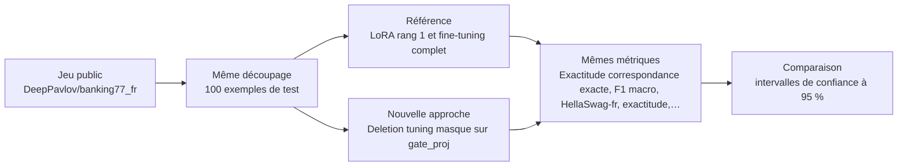
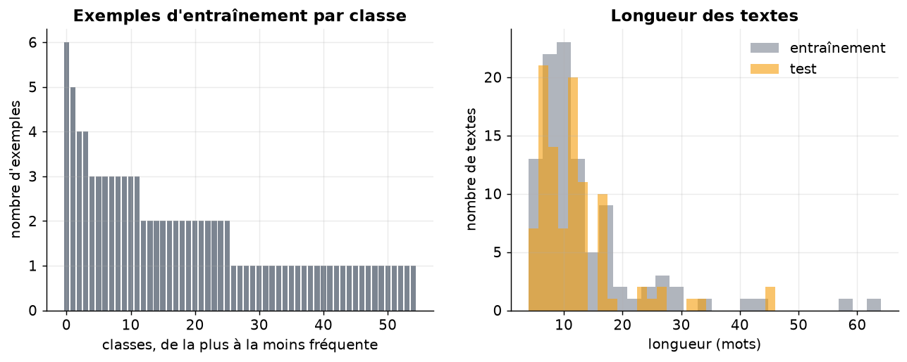
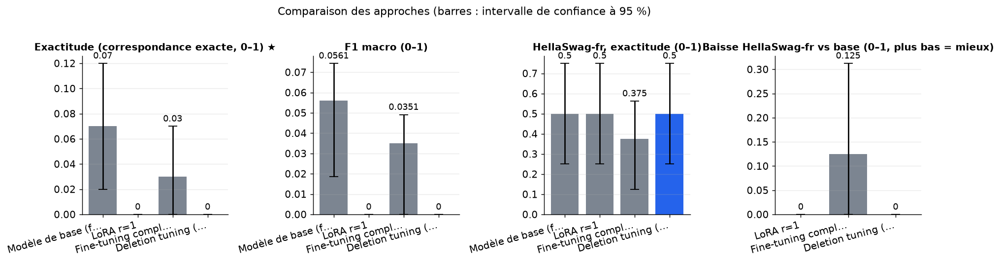
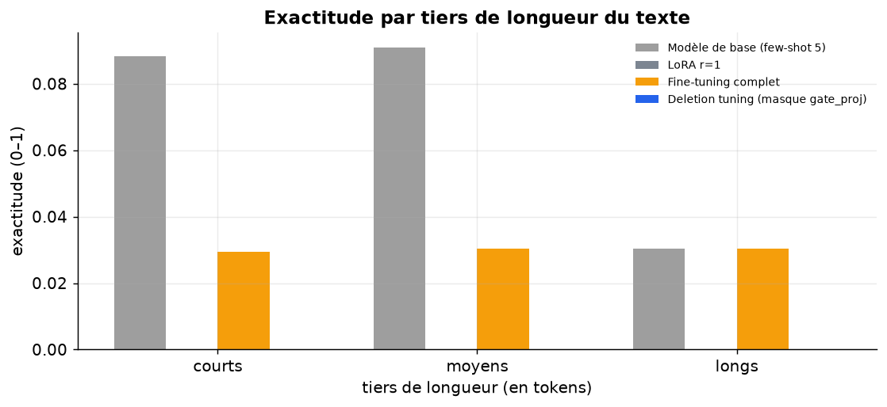
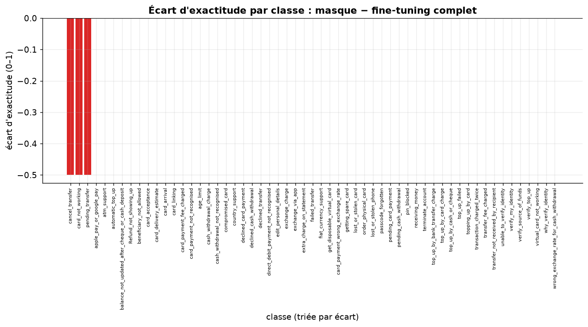
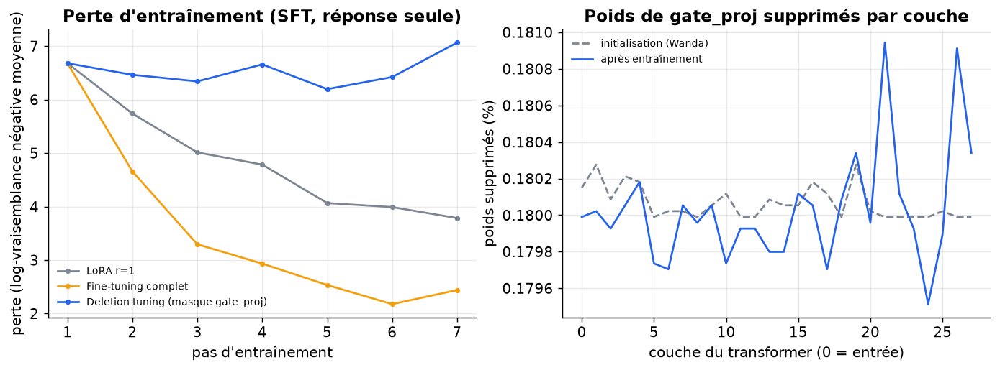
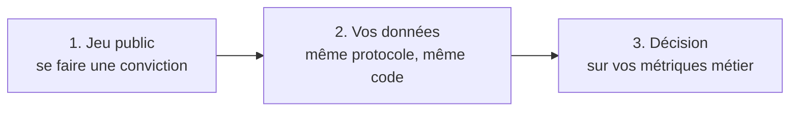

# Un masque appris de suppression de poids (gate_proj) égale-t-il LoRA et le fine-tuning complet en français sur une tâche à réponse exacte, avec moins d'oubli ?

> **En bref.** Aucune approche entraînée n'a réellement appris à cette échelle : l'hypothèse sur le masque et l'oubli reste non tranchée. La méthode n'est ni confirmée ni infirmée ; la capacité d'apprentissage du masque reste à vérifier. Exactitude (correspondance exacte) : 0 [0 ; 0] pour Deletion tuning (masque gate_proj), contre 0,03 [0 ; 0,07] pour Fine-tuning complet (100 exemples de test, échelle réduite, chiffres indicatifs).

## Sommaire

1. [La question](#la-question)
2. [Le protocole](#le-protocole)
3. [Les résultats](#les-résultats)
4. [Ce qu'il faut retenir](#ce-quil-faut-retenir)
5. [Rejouer l'expérience](#rejouer-lexpérience)
6. [Contenu du dépôt](#contenu-du-dépôt)
7. [Références](#références)
8. [Glossaire](#glossaire)

## La question

Peut-on apprendre une nouvelle tâche à un modèle de langue sans changer la valeur d'aucun poids, en se contentant de mettre à zéro quelques poids bien choisis ? On le teste en français : il s'agit de classer de courtes demandes de clients d'un service financier parmi 77 intentions. On compare cette « suppression apprise » au fine-tuning complet et à LoRA, une adaptation légère courante. On mesure aussi combien chaque méthode fait oublier au modèle ses connaissances générales, sur un test de bon sens en français. Une comparaison n'est retenue que si les méthodes concernées ont vraiment appris la tâche. Sinon, le notebook affiche de lui-même « non concluant » au lieu d'un faux résultat.

**Hypothèse testée.** Sur Qwen3-0.6B en SFT, le masque atteint au moins 95 % de l'exactitude du fine-tuning complet sur la classification d'intentions, avec une perte de précision hors tâche (HellaSwag français) inférieure de 1 point à celle de LoRA r=1.

| | Référence | Nouvelle approche |
|---|---|---|
| **Approche** | LoRA rang 1 et fine-tuning complet | Deletion tuning (masque sur gate_proj) |
| **Principe** | Deux références du même modèle de départ : LoRA r=1 sur les projections MLP et fine-tuning complet, à données et pas égaux. | Un logit par poids de gate_proj, masque doux sigmoïde progressivement durci, initialisé par un score Wanda ; seul le masque est entraîné, le modèle reste gelé. |
| **Mise en œuvre** | transformers + peft ; SFT sur « texte → nom de classe », perte sur la réponse, 1 époque sur 3000 exemples, batch 16 ; FFT lr 1e-5, LoRA lr 2e-4 ; décodage glouton, correspondance exacte du nom. | Réimplémentation : remplacement de gate_proj par une couche masquée (W·sigmoid(logit/τ)), τ décroissant, init des logits depuis \|W\|×norme d'activation sur 128 exemples avec ~0,2 % de suppression, durcissement final à seuil 0 ; logits en fp32, lr 0,05 ; taille du masque compressée rapportée. |
| **Modèles** | [`Qwen/Qwen3-0.6B`](https://huggingface.co/Qwen/Qwen3-0.6B) | [`Qwen/Qwen3-0.6B`](https://huggingface.co/Qwen/Qwen3-0.6B) |

## Le protocole



- **Données** : [`DeepPavlov/banking77_fr`](https://huggingface.co/datasets/DeepPavlov/banking77_fr) (configuration `default`), évaluation sur le découpage `test` (100 exemples). Tâche française à réponse exacte et vérifiable proche du routage, 77 classes proches, plus test d'oubli de bon sens.
- **Écarts avec des données réelles** : Traduction automatique, textes courts, classes plates, modèle 0,6 B où la méthode n'égale pas le fine-tuning complet selon les auteurs ; SFT et non GRPO ; licences des jeux à clarifier.
- **Déroulé** : Entraînement sur 3000 exemples tirés au hasard du split train de banking77_fr. Les noms de classes viennent de mteb/banking77, alignés par indice, et l'alignement est vérifié. L'évaluation porte sur 1000 exemples du split test, en décodage glouton et correspondance exacte ; les sorties hors liste comptent comme erreurs. Quatre bras partent de Qwen3-0.6B et voient les mêmes lots, dans le même ordre : base en few-shot 5, LoRA r=1 (lr 2e-4), fine-tuning complet (lr 1e-5) et masque appris sur gate_proj (lr 0,05, init Wanda). Chaque bras entraîné fait 1 époque, en lots de 16. L'oubli est mesuré sur 500 exemples de french_bench_hellaswag par acc_norm, avec les choix gardés exemple par exemple. Les intervalles à 95 % viennent d'un bootstrap apparié. Chaque volet de l'hypothèse est déclaré non concluant si l'un de ses bras n'est pas exploitable : exactitude pas au-dessus du prédicteur trivial, ou sorties identiques à la base. Un intervalle de largeur nulle est signalé comme dégénéré.
- **Deux échelles, un seul code** : l'échelle réduite (100 exemples, CPU, 10 min) valide la mécanique ; l'échelle complète n'a pas été exécutée (exception (cellule 45, section reference)) : résultats indicatifs.



*À gauche, le nombre d'exemples d'entraînement par classe (une barre par classe, triées) ; à droite, la longueur des textes en mots, entraînement et test superposés.*

**Les métriques**

| Métrique | Ce qu'elle mesure | Meilleur si |
|---|---|---|
| Exactitude (correspondance exacte) ★ | Part des demandes pour lesquelles le modèle écrit exactement le bon nom d'intention. | plus haut |
| F1 macro | Moyenne, sur les intentions, de l'équilibre entre précision et rappel ; chaque intention pèse autant. | plus haut |
| HellaSwag-fr, exactitude | Part des phrases de bon sens dont le modèle choisit la bonne fin parmi 4, après adaptation. | plus haut |
| Baisse HellaSwag-fr | Perte d'exactitude sur le test de bon sens par rapport au modèle d'origine (oubli) ; sans valeur si l'intervalle est de largeur nulle. | plus bas |
| Taille de l'adaptateur (Mo) | Place nécessaire pour stocker ce qui distingue le modèle adapté du modèle d'origine. | plus bas |
| Paramètres entraînés | Nombre de valeurs ajustées pendant l'entraînement. | — |

★ métrique principale : c'est elle qui tranche la question.

## Les résultats

| Approche | Exactitude (correspondance exacte) ★ ↑ | F1 macro ↑ | HellaSwag-fr, exactitude ↑ | Baisse HellaSwag-fr ↓ | Taille de l'adaptateur (Mo) ↓ | Paramètres entraînés | Latence médiane (ms) ↓ |
|---|---|---|---|---|---|---|---|
| Modèle de base (few-shot 5) (référence) | **0,07 [0,02 ; 0,12]** | **0,0561 [0,0187 ; 0,0744]** | **0,5 [0,25 ; 0,75]** | — | — | — | 1,11e+03 |
| LoRA r=1 (référence) | 0 [0 ; 0] | 0 [0 ; 0] | **0,5 [0,25 ; 0,75]** | 0 [0 ; 0] | 0,688 | 3,44e+05 | 310 |
| Fine-tuning complet (référence) | 0,03 [0 ; 0,07] | 0,0351 [0 ; 0,0491] | 0,375 [0,125 ; 0,562] | 0,125 [0 ; 0,312] | 881 | 4,4e+08 | 308 |
| Deletion tuning (masque gate_proj) (nouvelle approche) | 0 [0 ; 0] | 0 [0 ; 0] | **0,5 [0,25 ; 0,75]** | 0 [0 ; 0] | 0,129 | 8,81e+07 | 410 |

★ métrique principale · ↑ plus haut = meilleur · ↓ plus bas = meilleur · entre crochets : intervalle de confiance à 95 % (bootstrap) · en gras : la meilleure valeur.



*Une barre par approche et par métrique, avec l'intervalle de confiance à 95 % ; exactitude et F1 : plus haut = mieux ; baisse HellaSwag : plus bas = moins d'oubli.*



*Exactitude de chaque approche sur les textes courts, moyens et longs (tiers du jeu évalué) ; des barres proches indiquent un écart indépendant de la longueur.*



*Pour chaque classe, exactitude du masque moins celle du fine-tuning complet ; vert : le masque fait mieux, rouge : moins bien. Peu d'exemples par classe : lire la tendance.*



*À gauche, la perte par pas des trois approches entraînées ; à droite, la part de poids supprimés par couche par le masque, avant (pointillés) et après entraînement.*

**Lecture** (confiance faible). À l'échelle réduite (100 exemples d'entraînement, 7 pas, 100 de test, 16 de contrôle d'oubli), aucun bras entraîné n'a appris la tâche. L'exactitude est de 0 % pour le masque et LoRA r=1 et de 3 % pour le fine-tuning complet, contre 7 % pour le modèle de base, avec 96 à 100 % de sorties hors liste. Le masque pèse 0,13 Mo (contre 0,69 Mo pour LoRA) pour 88 M de paramètres entraînés, mais seuls 1 223 poids ont basculé depuis l'initialisation Wanda. Les deux volets de l'hypothèse (95 % du fine-tuning complet, moins d'oubli que LoRA) sont donc non concluants. Ces chiffres ne permettent pas de trancher et ne sont pas comparables à ceux de l'article (autre tâche, autre taille, SFT). Les points ouverts avant toute décision sont la capacité d'apprentissage du masque avec ces réglages, le contrôle d'oubli sur trop peu d'exemples et l'absence de répétition.

## Ce qu'il faut retenir

**Réserves**

- Si le masque ne réussit pas à apprendre, il se comporte comme un simple élagage Wanda. Un mauvais score serait alors dû aux réglages de cette réimplémentation, pas à la méthode des auteurs.
- Le volet « moins d'oubli » n'est pas mesurable avec 16 exemples : le moindre écart observé est du bruit.

**Limites**

- Une seule exécution par bras : la variance due à la graine et à l'échantillon d'entraînement n'est pas mesurée.
- Jeu traduit automatiquement et textes courts : la difficulté diffère sans doute de celle de demandes réelles.
- Modèle de 0,6 B paramètres, taille où les auteurs eux-mêmes n'observent pas l'égalité avec le fine-tuning complet. Il y a aussi un écart avec la source : SFT au lieu de GRPO, calendrier de température choisi par nous.
- Le contrôle d'oubli porte sur 500 exemples HellaSwag : un écart de 1 point reste proche de la résolution du test.
- À l'échelle réduite, trop peu de pas pour adapter les modèles : aucune conclusion n'en est tirée, seulement la validation du code.

**Pistes d'amélioration**

- Sans répétition ni réglage, les écarts proches de l'intervalle de confiance ne permettent pas de classer les approches.
- L'avantage de taille du masque sur LoRA vient en partie de la compression et d'un masque qui reste proche de l'initialisation, pas seulement de ce qui a été appris.
- Les écarts de latence reflètent surtout la longueur de l'invite et des sorties générées, pas le coût de la méthode.

## Rejouer l'expérience



### Sur le jeu public

```bash
pip install -r requirements.txt
jupyter lab experiment.ipynb
```

Dans la cellule de paramètres : `PHASE = "public"`, puis `SCALE = "reduced"` (quelques minutes sur CPU, pour vérifier) ou `SCALE = "full"` (résultats publiés). Les résultats sont écrits dans `outputs/results_public.json`, les figures dans `outputs/figures/` (les résultats publiés en sont une copie, dans `results/` et `figures/`).

### Sur vos données (environnement de services financiers)

Le même protocole, sur vos données, dans votre environnement : seule la cellule `PRIVATE_CONFIG` s'adapte. Le code de cette phase a été exécuté de bout en bout sur un jeu factice écrit comme un vrai export (dossier de fichiers, CSV « ; » en Windows-1252, colonnes à faire correspondre), contre un service simulé à la convention OpenAI (clé lue dans un fichier de secret), modèles chargés hors ligne.

**1. Préparer le jeu de données.** Colonnes attendues (les noms peuvent différer : on les fait correspondre dans `PRIVATE_CONFIG["columns"]`) :

| Colonne attendue | Type | Contenu |
|---|---|---|
| `text` | string | Texte à classer, anonymisé |
| `label` | string | Classe cible exacte |
| `received_at` | datetime | Date de réception |

Volume conseillé : ≥ 5 000 textes d'entraînement, ≥ 20 par classe, 1 500 en test

**Conditions pour que la comparaison soit concluante**

- Au moins 20 textes par classe en entraînement
- Découpage temporel pour le test
- Jeu de contrôle hors tâche interne distinct pour mesurer l'oubli
- Étiquettes validées et noms de classes stables
- Anonymisation avant extraction
- Répéter sur plusieurs échantillons d'entraînement si possible

**Constituer l'extraction.** Extraire textes et classe finale validée, anonymiser, découper par date, constituer un jeu de contrôle de tâches voisines non entraînées, aligner les noms de classes.

**2. Rendre les modèles disponibles hors ligne** (si l'environnement n'a pas accès à Internet) :

```bash
python download_models.py ./models --scale full   # sur un poste connecté
```

puis copier le dossier dans l'environnement et le désigner par `LOCAL_MODELS_DIR`. Les révisions téléchargées sont celles des résultats publiés.

**3. Configurer** l'environnement du notebook à partir de `private.env.example` (ou directement la cellule `PRIVATE_CONFIG`). Jamais de clé dans le notebook : une variable, un fichier de secret monté ou la saisie masquée.

| Variable | Rôle |
|---|---|
| `PRIVATE_DATA` | jeu de données : fichier ou dossier (csv, tsv, parquet, jsonl, json, xlsx) ; `fake` pour tester le code sur un jeu factice |
| `LOCAL_MODELS_DIR` | (facultatif) dossier des poids copiés localement (`org--nom/`), pour travailler sans Internet |
| `HTTPS_PROXY, SSL_CERT_FILE, PIP_INDEX_URL` | (facultatif) proxy, autorité de certification et miroir PyPI d'entreprise |
| `SERVICE_TIMEOUT_S, SERVICE_MAX_RETRIES` | (facultatif) délai (120 s) et tentatives (3) par appel de service |

**4. Lancer** avec `PHASE = "private"` (et `SCALE = "full"`). La cellule d'initialisation affiche une liste de contrôle (jeu, colonnes, modèles, services) et s'arrête sur ce qui manque, avant tout calcul. Les résultats sont écrits dans `outputs/results_private.json` (avec versions, machine, graine et empreinte des données).

**5. Interpréter.** Métriques métier à suivre : Exactitude de routage, taille d'adaptateur par tâche, dégradation sur un jeu de contrôle interne non lié.

**Garde-fous.** Contrôler la régression sur tâches hors périmètre ; sorties hors liste rejetées ; modèle local seulement. En phase `private`, le notebook refuse les services publics (OpenAI, Anthropic, Mistral, Hugging Face…) et le HTTP non chiffré, n'affiche aucune donnée brute et coupe la télémétrie des bibliothèques ; avec `LOCAL_MODELS_DIR`, il travaille sans accès à Internet.

## Contenu du dépôt

| Fichier | Contenu |
|---|---|
| `experiment.ipynb` | le notebook : question, données, deux approches, évaluation, analyse, bilan (sorties incluses) |
| `helpers.py` | fonctions communes : phases et échelles, services internes, lecture des données, mesures, figures |
| `results/results.json` | résultats publiés (échelle réduite) : métriques, intervalles, latences, versions et machine |
| `figures/` | figures du notebook reprises dans ce README |
| `requirements.txt` | versions exactes des bibliothèques utilisées |
| `private.env.example` | variables d'environnement pour exécuter le notebook sur vos données |
| `download_models.py` | téléchargement des poids des modèles, pour un environnement sans Internet |

## Références

**Sources de l'approche**

- [The Surprising Effectiveness of Deleting Weights in LLM Post-Training](https://arxiv.org/abs/2611.10866)
- [Reddit r/LocalLLaMA : The Surprising Effectiveness of Deleting Weights in LLM Post-Training](https://www.reddit.com/r/LocalLLaMA/comments/1xswmb7/the_surprising_effectiveness_of_deleting_weights/)

**Autres jeux de données examinés**

| Jeu | Accès | Intérêt | Pourquoi pas ici |
|---|---|---|---|
| [cea-list-ia/MathAleaQA](https://huggingface.co/datasets/cea-list-ia/MathAleaQA) | Hugging Face, libre | Maths françaises, grande taille, réponse vérifiable. | Gabarits, bruit, cc-by-sa et pas de lien métier ; modèle 0,6 B trop faible. |
| [juletxara/mgsm](https://huggingface.co/datasets/juletxara/mgsm) | Hugging Face, libre | 250 problèmes en français. | Trop petit, pas de train français. |
| [openai/gsm8k](https://huggingface.co/datasets/openai/gsm8k) | Hugging Face, libre | Benchmark de l'article, anglais. | Anglais, GRPO hors budget. |
| [kurakurai/IFEval-FR](https://huggingface.co/datasets/kurakurai/IFEval-FR) | Hugging Face, libre | 235 consignes vérifiables. | Vérificateur à implémenter, trop petit. |
| [FreedomIntelligence/MMLU_French](https://huggingface.co/datasets/FreedomIntelligence/MMLU_French) | Hugging Face, libre | QCM traduits. | En-têtes mal formés, traduction automatique. |

**Licences**

- Jeu de données `DeepPavlov/banking77_fr` : voir sa fiche
- `Qwen/Qwen3-0.6B` : apache-2.0
- Vérifier la licence de chaque modèle avant tout usage au-delà de l'évaluation.

## Glossaire

| Terme | Définition |
|---|---|
| **Fine-tuning complet (FFT)** | Réentraîner tous les poids du modèle sur la nouvelle tâche. |
| **LoRA** | Adaptation légère : on ajoute à chaque matrice une petite correction de faible rang, seule entraînée. |
| **Deletion tuning** | Adaptation par suppression : on apprend quels poids mettre à zéro, sans changer les autres. |
| **Score Wanda** | Importance d'un poids estimée par sa valeur absolue multipliée par l'intensité de l'entrée qu'il reçoit. |
| **Oubli** | Perte de capacités générales du modèle après son adaptation à une tâche précise. |
| **Bootstrap apparié** | Tirer au hasard les mêmes exemples pour deux approches, des centaines de fois, pour mesurer l'incertitude de leur écart. |
| **Intervalle dégénéré** | Intervalle de confiance de largeur nulle : il signale que rien ne varie, par exemple entre deux modèles identiques, et non une mesure précise. |
| **Bras exploitable** | Approche dont l'exactitude dépasse nettement le prédicteur trivial et dont les sorties diffèrent de celles du modèle d'origine. |
| **Prédicteur trivial** | Règle naïve qui répond toujours l'intention la plus fréquente ; un modèle utile doit faire mieux. |
